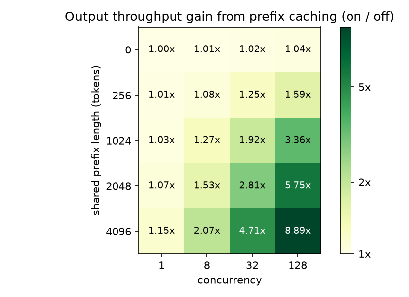

# vLLM Prefix Caching Benchmark Harness

A reproducible benchmark of vLLM prefix caching: the same model served with
the cache on and off, across shared-prefix length and concurrency, measuring
time to first token (TTFT), time per output token (TPOT) and output throughput.

## Results

Qwen2.5-7B-Instruct on one NVIDIA A40, vLLM 0.33.0. 150 runs of 500 requests,
medians of 3 repeats. Full analysis: [analysis/REPORT.md](analysis/REPORT.md).

| Shared prefix / concurrency | Metric | Cache off | Cache on | Change |
|---|---|---|---|---|
| 2,048 tokens / 32 | Output throughput | 277 tok/s | 778 tok/s | 2.8x |
| 2,048 tokens / 32 | p99 TTFT | 8.9 s | 1.2 s | −86% |
| 2,048 tokens / 32 | p50 TTFT | 1,540 ms | 660 ms | −57% |
| 4,096 tokens / 128 | Output throughput | 135 tok/s | 1,196 tok/s | 8.9x |
| 4,096 tokens / 128 | p50 TTFT | 67.5 s | 1.7 s | −97% |
| none / 32 | Output throughput | 837 tok/s | 855 tok/s | 1.02x |

What the data shows:

- The gain grows with prefix length and concurrency. Under load, prefill is
  the bottleneck, and the cache removes most of it.
- Decoding itself is not faster: TPOT is identical at concurrency 1. Under
  load TPOT still drops (102.8 → 35.7 ms at prefix 2048, concurrency 32)
  because other requests' prefill no longer delays decode steps.
- With `gpu_memory_utilization` lowered from 0.9 to 0.5, the cache-off server
  preempted requests at concurrency 128 and the cache-on server did not: a
  shared prefix is stored once.
- Greedy outputs are reproducible within a cache state but differ between
  cache states, so exact-match tests must pin the cache state.

Known limitations (a synthetic single-prefix workload, closed-loop load, and a
warm-up overlap that makes 10% of measured requests full-prompt hits) are
documented in the report.

These numbers were produced by the first version of the harness (commit
`1be108b`). A review of that version found measurement and reliability
problems, listed in the report. The scripts in this repository are now the
rewritten harness (v2); clean reference runs made with it will be reported
next to the numbers above, not merged into them.

## How it works

Each run starts a fresh server in its own process group, checks that the
server answering on the port is the one it started, sends warm-up requests,
reads the Prometheus counters, sends the measured requests with
`vllm bench serve`, and reads the counters again. The counter difference
therefore covers the measured requests only.

- **Prompts.** `make_workload.py` writes the prompt files: every prompt has an
  exact token count, all prompts share the same prefix tokens, and no measured
  prompt repeats a warm-up prompt.
- **Resume.** A run folder is named after a hash of its full config and
  environment, each retry is kept as a separate attempt, and a run is skipped
  only if its files and request counts check out.
- **Failures.** A missing metric, a counter that went down, a failed request
  or a server that died is an error. The sweep exits non-zero unless every run
  has a valid result.
- **Provenance.** Each run records the model revision, `pip freeze`, the
  server's start-up settings and the source commit, and the sweep refuses to
  start if the scripts differ from the last commit.

    pip install -r requirements.txt
    python scripts/make_workload.py configs/matrix_clean24.yaml
    python scripts/run_matrix.py configs/matrix_clean24.yaml
    python analysis/load_results_v2.py results_v2 analysis/runs_v2.csv

## Tests

The harness is tested without a GPU against a stand-in for the `vllm` command
(`tests/fake_vllm.py`): process cleanup, changed settings, missing files,
missing metrics, failed requests and prompt generation.

    pip install -r requirements-dev.txt
    pytest -q

## Layout

| Path | Contents |
|---|---|
| `configs/` | sweep definitions |
| `scripts/` | generate prompts, start/stop server, run benchmark, scrape metrics, run a sweep |
| `tests/` | CPU-only tests and the fake `vllm` command |
| `checks/` | greedy-output comparison across cache states |
| `analysis/` | results loaders, plots, `runs.csv`, figures, report |
| `results/` | v1 results, one folder per run |
| `notes.md` | lab notes, including bugs found along the way |
