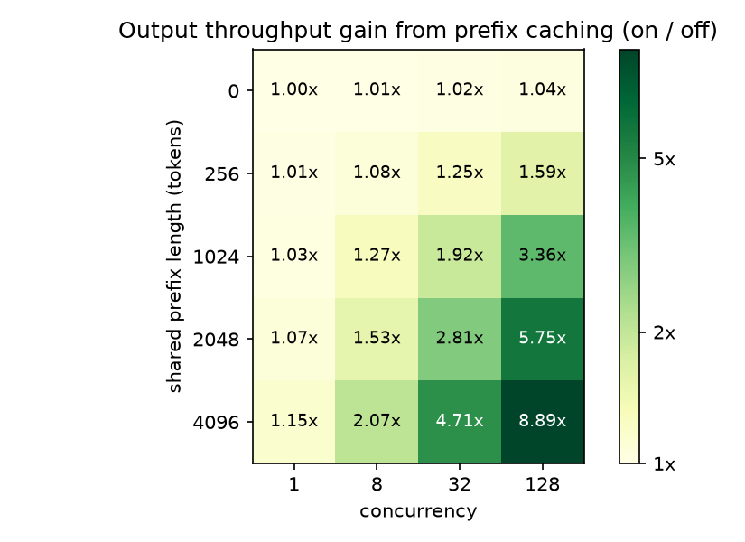
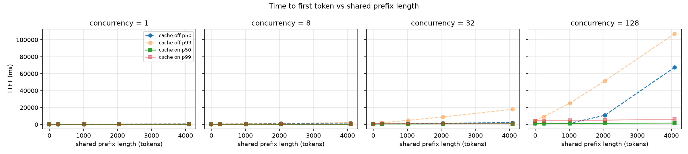

# Prefix caching in vLLM: benchmark report

Measured November 2026 on one NVIDIA A40. All numbers are medians of 3 repeats.

> These are the v1 results. The problems listed under Limitations led to a
> rewritten harness (v2, see the README). Clean reference runs made with it
> will be reported in a separate section and will not be merged into these
> numbers.

## Summary

- With a 2,048-token shared prefix and 32 concurrent requests, prefix caching
  raised output throughput 2.8x (277 → 778 tok/s), cut p99 TTFT from 8.9 s to
  1.2 s and cut median TTFT from 1,540 ms to 660 ms.
- The gain grows with prefix length and with concurrency: 1.00x throughput at
  no shared prefix and concurrency 1, up to 8.9x at a 4,096-token prefix and
  concurrency 128, where median TTFT fell from 67.5 s to 1.7 s.
- Caching does not make decoding faster (TPOT is identical at concurrency 1).
  It removes prefill work, and under load prefill is the bottleneck.
- With `gpu_memory_utilization` lowered from 0.9 to 0.5, the cache-off server
  preempted requests at concurrency 128; the cache-on server did not, because
  the shared prefix is stored once.
- Greedy outputs are reproducible within a cache state (50/50) but differ
  between cache states (17 to 21 of 50 identical).

## Setup

| Item | Value |
|---|---|
| GPU | NVIDIA A40, 46 GB (driver 595.91.07, CUDA 12.8) |
| Software | vLLM 0.33.0, PyTorch 2.14.0, Python 3.12.3 |
| Model | Qwen/Qwen2.5-7B-Instruct, bf16 |
| Server | `max_model_len` 8192, `gpu_memory_utilization` 0.90, `max_num_seqs` 256 |
| Load | `vllm bench serve`, `prefix_repetition` dataset, closed loop (`--max-concurrency`) |
| Request | one shared prefix + 256 random suffix tokens, 128 output tokens (`--ignore-eos`) |
| Main sweep | cache on/off x prefix 0/256/1024/2048/4096 x concurrency 1/8/32/128 |
| Per run | fresh server, 50 warm-up requests, then 500 measured requests |

150 runs in total (120 main, 18 block-boundary, 12 memory-pressure), 75,000
measured requests, 0 failed. Cache hit rate and preemptions come from the
difference in Prometheus counters scraped before and after each run.

## Results

### Throughput

Output tokens per second, cache off → cache on. Columns are concurrency.

| Prefix | 1 | 8 | 32 | 128 |
|---|---|---|---|---|
| 0 | 35.3 → 35.2 (1.00x) | 254.5 → 255.9 (1.01x) | 836.7 → 854.6 (1.02x) | 1,764 → 1,841 (1.04x) |
| 256 | 34.9 → 35.2 (1.01x) | 237.8 → 255.9 (1.08x) | 678.9 → 845.4 (1.25x) | 1,128 → 1,793 (1.59x) |
| 1024 | 33.9 → 35.1 (1.03x) | 198.7 → 252.5 (1.27x) | 424.7 → 816.0 (1.92x) | 488.0 → 1,640 (3.36x) |
| 2048 | 32.5 → 34.9 (1.07x) | 162.9 → 248.5 (1.53x) | 276.5 → 778.0 (2.81x) | 255.2 → 1,469 (5.75x) |
| 4096 | 29.9 → 34.4 (1.15x) | 116.9 → 241.5 (2.07x) | 150.4 → 709.1 (4.71x) | 134.5 → 1,196 (8.89x) |

With the cache off, throughput at long prefixes is lower at concurrency 128
than at 32 (255 vs 277 tok/s at prefix 2048): the server is saturated by
prefill. `figures/fig2_throughput_vs_concurrency.png` shows the same thing.

### Latency at a 2,048-token prefix

Milliseconds, cache off → cache on.

| Concurrency | p50 TTFT | p99 TTFT | mean TPOT |
|---|---|---|---|
| 1 | 348 → 83 | 373 → 99 | 28.2 → 28.2 |
| 8 | 1,140 → 215 | 1,399 → 379 | 40.4 → 30.4 |
| 32 | 1,540 → 660 | 8,929 → 1,215 | 102.8 → 35.7 |
| 128 | 10,838 → 1,438 | 51,486 → 5,103 | 385.5 → 72.5 |

End-to-end latency in milliseconds (request sent to last token), cache off →
cache on. It does not include the wait in the client-side concurrency queue.

| Concurrency | p50 E2E | p99 E2E |
|---|---|---|
| 1 | 3,934 → 3,668 | 3,954 → 3,684 |
| 8 | 6,259 → 4,095 | 6,527 → 4,161 |
| 32 | 14,737 → 5,180 | 22,266 → 5,486 |
| 128 | 65,779 → 10,956 | 106,563 → 14,699 |

### Why the gain depends on concurrency

At concurrency 1, median TTFT is linear in prefix length: about
55 ms + 0.147 ms per prefix token with the cache off, and
61 ms + 0.011 ms per token with it on. A single request then spends about
3.6 s decoding 128 tokens (28 ms each), so removing at most 0.6 s of prefill
gains at most 15%.

Under concurrency, decode steps are batched across requests, but every request
still pays for its own prefill (2,304 input tokens against 128 output tokens).
Prefill becomes the dominant cost, and the cache removes most of it.

TPOT shows the same effect. At prefix 2048 it is 28.2 ms with or without the
cache at concurrency 1, so caching does not speed up decoding itself. At
concurrency 32 it is 102.8 ms without the cache and 35.7 ms with it: other
requests' prefill shares engine steps with decoding and delays every in-flight
request.

The 67.5 s median TTFT at prefix 4096, concurrency 128, cache off is queueing:
the same request takes 662 ms at concurrency 1.

### Block boundaries

vLLM caches whole 16-token blocks. Concurrency 32, cache on:

| Prefix | Reusable prefix tokens | Hit rate | tok/s, median (range) | p99 TTFT (ms) |
|---|---|---|---|---|
| 2048 | 2048 | 0.8967 | 778.0 (777.8–778.4) | 1,215 |
| 2050 | 2048 | 0.8966 | 774.1 (772.3–776.6) | 1,192 |
| 2063 | 2048 | 0.8916 | 770.0 (766.5–770.3) | 1,249 |
| 2064 | 2064 | 0.8974 | 776.9 (776.1–777.7) | 1,162 |

At 2,063 tokens the last 15 prefix tokens fall outside a full block and are
recomputed for every request. The hit rate drops as predicted and throughput
is 1.0% lower than at 2,048, with non-overlapping ranges across repeats; both
recover at 2,064. The effect is consistent but small. Median TTFT is too noisy
to show it.

### Memory pressure

`gpu_memory_utilization` 0.5 instead of 0.9, prefix 2048. These runs also used
`max_model_len` 16384 instead of 8192 (see Limitations).

| Concurrency | Cache | p50 TTFT (ms) | p99 TTFT (ms) | TPOT (ms) | tok/s | tok/s at 0.9 | Preemptions |
|---|---|---|---|---|---|---|---|
| 32 | off | 1,254 | 8,944 | 103.5 | 276.1 | 276.5 | 0 |
| 32 | on | 664 | 1,227 | 35.5 | 772.8 | 778.0 | 0 |
| 128 | off | 35,030 | 53,718 | 175.7 | 273.9 | 255.2 | 18 |
| 128 | on | 1,563 | 5,252 | 73.1 | 1,447 | 1,469 | 0 |

Concurrency 32 is unaffected. At concurrency 128 the two servers behave
differently:

- Cache off: 18 preemptions in every repeat, and median TTFT rose from 10.8 s
  to 35.0 s. TPOT improved (385.5 → 175.7 ms) and throughput rose 7%, because
  the smaller KV pool limits how many sequences run at once: the server log
  shows about 51 running and 75 waiting at 95% KV usage, against about 109
  running at 56% with the 0.9 setting (`analysis/kv_cache_log.txt`, repeat 0).
- Cache on: no preemptions and 1.5% lower throughput.

Without the cache, 128 requests need KV memory for 128 x 2,432 = 311,296
tokens. With it, the prefix is stored once: 2,048 + 128 x 384 = 51,200 tokens.
The KV pool holds 459,936 tokens at 0.9 and 127,216 at 0.5, so at 0.5 only the
cache-on demand fits (127,216 / 2,432 = 52 full sequences).
I expected cached blocks to compete with active requests for memory; with a
single shared prefix the opposite happened. A workload with many distinct
prefixes is needed to test that case.

### Output correctness

50 prompts, temperature 0, sequential requests, first 64 tokens compared
(`checks/`):

| Comparison | Identical |
|---|---|
| cache off vs cache off (repeat) | 50/50 |
| full-prompt hit vs full-prompt hit (repeat) | 50/50 |
| cache off vs prefix hit | 17/50 |
| cache off vs full-prompt hit | 19/50 |
| prefix hit vs full-prompt hit | 21/50 |

For these 50 prompts, outputs are deterministic for a given cache state and
differ across cache states. A possible cause is small bf16 numeric differences
between computing attention inputs and reading them from cached blocks, which
could flip near-tie argmax decisions; I did not test this. I also did not
measure output quality, so this check says nothing about whether the outputs
of the two states are equally good. Any test that asserts exact
reproducibility must pin the cache state.

## Measurement noise

Spread across the 3 repeats, (max − min) / median, over the 46 main and
block-boundary configurations:

| Metric | Median spread | Largest spread |
|---|---|---|
| Output throughput | 0.1% | 1.3% |
| p99 TTFT | 3.4% | 19% |
| p50 TTFT | 8% | 32% |

Mean TPOT varied by at most 3.5%. Median TTFT is the least stable
metric: in this closed-loop load it lands on one of two values (about 1,250 or
1,540 ms across the 12 cache-off runs at prefix 2048 to 2064, concurrency 32). I
therefore do not interpret p50 TTFT differences below about 30% and rely on
throughput, TPOT and p99 TTFT.

## Limitations

- **Warm-up overlap.** Warm-up and measurement both use `--seed 0`, so 50 of
  the 500 measured prompts (shuffled among the rest) repeat the warm-up
  prompts and are full-prompt cache hits. The counters confirm it: prefix-0
  runs record exactly 12,000 hit tokens (50 requests x 240). Cache-on numbers
  therefore include 10% full-hit requests, the measured hit rate at prefix
  2048 is 0.897 instead of 0.889, and the prefix-0 row (1.00x to 1.04x) is not
  a pure overhead control. Changing only the warm-up seed would not fix it:
  the shared prefix is generated from the same seed and would change too.
- **Counters include the warm-up.** They were read before the warm-up, so the
  hit rate and preemption counts cover 550 requests, not the 500 measured.
- **Best-case workload.** One shared prefix, random-token suffixes and
  fixed-length outputs. Real traffic has many prefixes and variable lengths.
- **Closed loop.** A fixed number of in-flight requests, not open-loop
  arrivals, so latency under overload reflects the client as well.
- **Aggregates only for TTFT and TPOT.** They come from the default
  `vllm bench serve` output: p99 is the per-run p99, then the median of 3
  runs, and there is no p95. End-to-end latency is computed from the
  per-request `latencies` field.
- **The memory-pressure runs change two settings.** They lower
  `gpu_memory_utilization` and also raise `max_model_len`, so the comparison
  with the main sweep is not a single-variable change.
- **Provenance.** Every `env.json` says `git_dirty: true`, because the growing
  `results/` folder counted as a change, and the recorded commit hashes
  predate a history rewrite (see `notes.md`). A run cannot be tied to an
  exact source state.
- **Harness.** The v1 runner stopped servers with a machine-wide `pkill`,
  read a missing counter as zero, and decided whether to skip a run from its
  name alone. I found no sign that this affected the committed results (the
  machine had one tenant, all seven counters are present in all 300 metric
  snapshots, and the name collisions that did happen were found and re-run),
  but nothing guarded against it.
- **Scope.** One model, one GPU, one vLLM version, 3 repeats.

## Reproduce

    pip install -r requirements.txt
    python scripts/run_matrix.py configs/matrix_main.yaml
    python scripts/run_matrix.py configs/matrix_block.yaml
    python scripts/run_matrix.py configs/matrix_pressure.yaml
    python analysis/load_results.py results analysis/runs.csv
    python analysis/plots.py analysis/runs.csv analysis/figures

The main sweep took about 24 hours on one A40. Runs are resumable.

These commands are for the v1 harness that produced the numbers above
(commit `1be108b`). The current scripts are the v2 harness; see the README.
